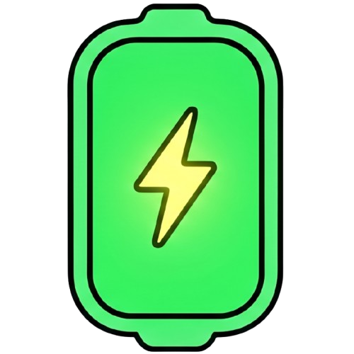
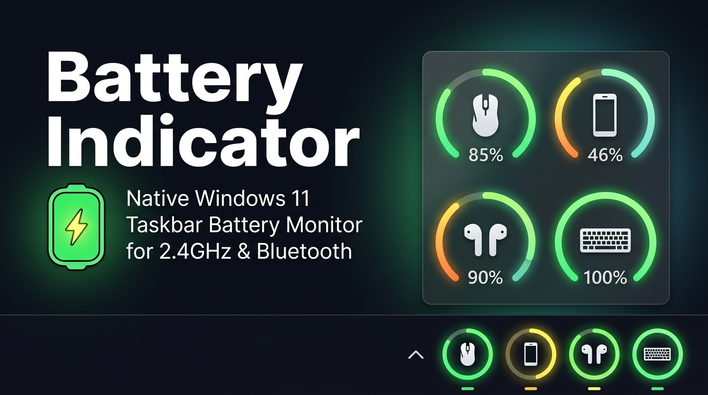

# 🔋 Battery Indicator for Windows

<p align="center">
  
</p>

<p align="center">
  <strong>Native Windows 11 taskbar battery monitor for 2.4GHz Wireless Dongles, Bluetooth devices, TWS Earbuds, Mechanical Keyboards, Gamepads, and UPS.</strong>
</p>

<p align="center">
  <a href="https://github.com/ParvShah2001/Battery-Indicator-for-Windows"></a>
  <a href="https://dotnet.microsoft.com/"></a>
  <a href="https://github.com/ParvShah2001/Battery-Indicator-for-Windows"></a>
  <a href="https://github.com/ParvShah2001/Battery-Indicator-for-Windows/blob/main/LICENSE"></a>
  <a href="https://github.com/ParvShah2001/Battery-Indicator-for-Windows/releases"></a>
  <a href="https://github.com/microsoft/winget-pkgs"></a>
</p>

<p align="center">
  
</p>

---

## 📌 Why Battery Indicator for Windows?

Windows has a notorious blind spot: **it cannot show the battery percentage of 2.4GHz wireless USB dongle mice, mechanical keyboards, gaming controllers, or TWS earbuds directly in your taskbar system tray**. Manufacturers force you to keep heavy, resource-hungry proprietary bloatware running (Razer Synapse, Logitech G HUB, etc.) just to check if your peripheral is about to die mid-game or mid-work.

**Battery Indicator for Windows** solves this with an ultra-lightweight, native, bloat-free Windows 11 utility that queries battery telemetry directly from low-level HID/SPP/GATT protocols and displays them right beside your Windows clock.

---

## ✨ Key Features

- **🔘 Dedicated System Tray Battery Gauges (`+` Pin Button)**
  - Click the **`+`** button on any device card to pin an independent, live circular battery gauge directly to your system tray.
  - Color-coded circular gauge (**Emerald Green** $>30\%$, **Amber Orange** $16\text{--}30\%$, **Crimson Red** $\le 15\%$) with the device's custom silhouette in the center and a live charging bolt badge.
  - Pin multiple devices simultaneously! Each pinned tray icon has its own quick context menu.
- **⚡ 2.4GHz USB Wireless Dongle Telemetry**
  - **Gaming Mice:** Logitech Lightspeed & Unifying (HID++ 2.0/1.0), Razer HyperSpeed, ATK / VXE / Compx (`0x07` frame), Corsair Slipstream, SteelSeries Aerox, Glorious.
  - **Mechanical Keyboards:** Keychron (K-Pro, Q-Max, V-Max), NuPhy (Air/Halo), Akko, Epomaker, Portronics Hydra 10, Areson wireless receivers.
- **🎧 True Wireless Stereo (TWS) Dual-Bud Support**
  - Independent **Left (`L`)** and **Right (`R`)** battery percentages with explicit connection mode tagging (e.g. `Bluetooth  •  L: 85%   R: 90%`).
  - Supports OnePlus Nord Buds 3r, Buds Pro 2, Oppo Enco, Realme, Sony WF-1000XM4/XM5, and Apple AirPods.
- **🔌 Uninterruptible Power Supply (UPS) Telemetry**
  - Live battery monitoring for APC, CyberPower, and standard HID Power Device UPS backup systems.
- **🧩 Crowdsourced Device Profiles (Plugin / JSON Database)**
  - Zero-code device expansion! Community members can add support for any peripheral by dropping a JSON profile into `%APPDATA%\BatteryIndicatorForWindows\Profiles\` without recompiling the application.
- **⌨️ Customizable Global Summon Shortcut**
  - Instant flyout popup from anywhere via keyboard shortcut (**Default: `Win + Alt + B`**).
  - Fully customizable to any keybind combination (Ctrl, Alt, Shift, Win + Key) via interactive Settings UI.
- **✏️ Device Aliases & Hidden Devices**
  - Right-click any device card to rename it with a custom nickname or hide unwanted secondary devices.
  - Unhide all devices in one click from the tray settings menu.
- **🛡️ Telemetry-Free, Local-Only Crash Reporting**
  - **Zero Telemetry Guarantee:** 100% offline. No analytics, tracking, or personal data transmitted to any external server.
  - When an unexpected error occurs, sanitized diagnostic logs (with all personal paths and usernames redacted) are stored strictly on your local disk in `%APPDATA%\BatteryIndicatorForWindows\CrashReports\`.
- **⚠️ Smart Low Battery Alerts**
  - Native Windows notifications when any peripheral reaches a configurable threshold (**default: <20%**, customizable from 5% to 50%).
  - Cooldown safeguard prevents notification spam.
- **🎨 Windows 11 Fluent Dark UI**
  - Multi-line word wrapping cleanly adapts to long peripheral names (e.g. *OnePlus Nord Buds 3r*) without marquee jitter.
  - Native Windows 11 Mica dark background, ClearType typography, and bulletproof cascading context menus.

---

## 🖥️ User Interface Preview

```
┌──────────────────────────────────────────────┐
│  🔋 Battery Indicator for Windows  [Refresh] │
├──────────────────────────────────────────────┤
│  [🖱️] Logitech G PRO X Superlight     85% [+] │
│      2.4 GHz                                 │
├──────────────────────────────────────────────┤
│  [⌨️] Keychron K2 Pro                  92% [+] │
│      2.4 GHz                                 │
├──────────────────────────────────────────────┤
│  [🎵] OnePlus Nord Buds 3r                    │
│      Bluetooth  •  L: 85%   R: 90%   85% [✓] │
├──────────────────────────────────────────────┤
│  [🎮] Xbox Wireless Controller        65% [+] │
│      Xbox Wireless                           │
├──────────────────────────────────────────────┤
│  [🔋] CyberPower CP1500PFCLCD         100% [+]│
│      USB / Wired                             │
├──────────────────────────────────────────────┤
│  Last updated - 01:00 PM         Devices - 5 │
└──────────────────────────────────────────────┘
```

---

## 📦 Installation & Distribution

### Option 1: Install via Windows Package Manager (WinGet)
```powershell
winget install ParvShah.BatteryIndicatorforWindows
```

### Option 2: Install via Scoop
```powershell
scoop bucket add extras
scoop install battery-indicator-for-windows
```

### Option 3: Pre-built Portable Binary
1. Download the latest release archive from [GitHub Releases](https://github.com/ParvShah2001/Battery-Indicator-for-Windows/releases).
2. Extract the folder and run **`Battery Indicator for Windows.exe`**.
3. The app will launch silently into your taskbar system tray.

### Option 4: Build MSIX Package
To package your own signed MSIX installer:
```powershell
powershell -ExecutionPolicy Bypass -File "Packaging\build-msix.ps1"
```

---

## 🧩 Crowdsourced Device Profiles

Battery Indicator features a plugin-based JSON profile architecture. You can easily add support for any wireless mouse, mechanical keyboard, or dongle without modifying C# code:

1. Open the tray context menu $\rightarrow$ **⚙️ Settings** $\rightarrow$ **📂 Custom Device Profiles Folder...**
2. Create a new `.json` file (e.g. `my_keyboard.json`):
```json
{
  "id": "custom_wireless_keyboard",
  "name": "Custom Wireless Keyboard",
  "vendor": "MyBrand",
  "category": "Keyboard",
  "connectionType": "Wireless24G",
  "vid": 13364,
  "nameContains": "MyBrand",
  "protocol": "HidFeatureReport",
  "reportId": 7,
  "reportLength": 64,
  "batteryByteOffset": 1,
  "chargingByteOffset": 2,
  "chargingBitMask": 1,
  "minRawValue": 0,
  "maxRawValue": 100,
  "customIcon": "keyboard.png"
}
```
3. Refresh devices $\rightarrow$ Battery Indicator will immediately detect and query your peripheral!

---

## 🛠️ Building from Source

### Prerequisites:
- **Windows 10 (version 19041+) or Windows 11 (22H2 / 23H2 / 24H2)**
- **[.NET 9.0 SDK](https://dotnet.microsoft.com/download/dotnet/9.0)**

### Build & Run:
```powershell
# Clone the repository
git clone https://github.com/ParvShah2001/Battery-Indicator-for-Windows.git
cd Battery-Indicator-for-Windows

# Build and run
dotnet run
```

### Publish Single-Folder Release:
```powershell
dotnet publish -c Release -r win-x64 --self-contained false -o publish
```

---

## 🎨 Custom Icons Guide

Place custom transparent `.png` or `.ico` files in `Resources\Icons\` (or `%APPDATA%\BatteryIndicatorForWindows\Icons\`) to customize device silhouettes:

| Filename | Purpose | Recommended Resolution |
| :--- | :--- | :--- |
| `app.png` or `app.ico` | Main App Logo & Master Tray Icon | 500x500 PNG / Multi-res ICO |
| `mouse.png` | Wireless gaming mice | 512x512 Transparent PNG |
| `keyboard.png` | Wireless mechanical keyboards | 512x512 Transparent PNG |
| `earbuds.png` | TWS In-ear buds | 512x512 Transparent PNG |
| `headphones.png` | Over-ear headsets | 512x512 Transparent PNG |
| `gamepad.png` | Wireless controllers | 512x512 Transparent PNG |
| `ups.png` | Uninterruptible power supplies | 512x512 Transparent PNG |
| `phone.png` | Smartphones & companion devices | 512x512 Transparent PNG |

---

## 🔒 Privacy & Telemetry Policy

Battery Indicator for Windows is strictly **100% Telemetry-Free**:
- Completely offline execution.
- No network requests, tracking analytics, or telemetry sent to any server.
- All crash logs are stored strictly on your local disk with usernames and personal file paths redacted.
- For full details, review our [Privacy Policy](PRIVACY.md).

---

## 🤝 Contributing & Community Profiles

Contributions, device profile submissions, and bug reports are warmly welcome!
- **Bug Reports & Feature Requests:** [GitHub Issues](https://github.com/ParvShah2001/Battery-Indicator-for-Windows/issues)
- **Submit Device Profiles:** Open a Pull Request adding your JSON profile to `Resources/device_profiles.json`.

---

## 📄 License

Distributed under the **MIT License**. See [LICENSE](LICENSE) for details.
